# qbar

[English](README.md)

qbar 是一个命令行工具，只需运行 `python3 qbar.py` 一个脚本即可工作。它读取 ADMIXTURE 的 `.Q` 矩阵文件，并对样本进行排序，其中 `.Q` 文件记录了每个样本归属于各个推断祖先群体的比例。它还能在不同的 K 值之间对齐列，这里的 K 值代表设定的祖先群体数量，最后绘制出展示群体遗传成分构成的群体结构条形图（支持 PNG 和 PDF 格式）。新功能不会改变默认行为，如果不加任何新选项，运行结果与之前完全一致。

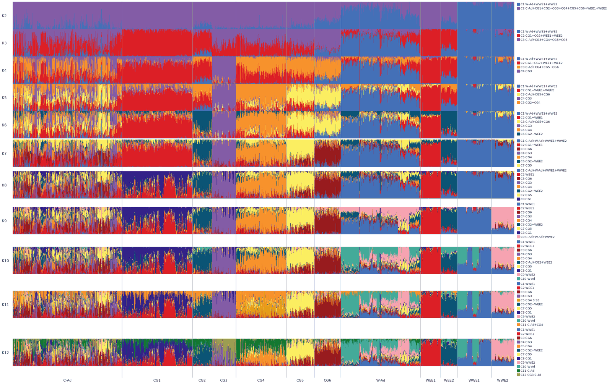

## 开始之前

命令行工具需要通过终端来运行，终端是一个靠输入文字命令来操作电脑的窗口。在 macOS 上请打开自带的终端（Terminal）应用，在 Linux 上请打开系统终端，在 Windows 上请使用 WSL（Windows 下的 Linux 子系统）。打开终端并进入 `qbar` 文件夹后，就可以直接输入并运行命令。

## 安装

运行 qbar 需要安装 Python 3 以及 `numpy` 和 `Pillow` 这两个基础扩展包。默认的贪心（greedy）对齐算法和所有其他基础功能只需要 `numpy` 和 `Pillow` 即可运行。只有在使用 `--within hclust`、`--within-group X=hclust`（以及所有 `--hclust-*` 选项）进行层次聚类排序，或者使用 `--align-method` 的 `hungarian`、`pong` 和 `jaccard` 对齐方法时，才需要额外用到科学计算包 `scipy`。`scipy` 已经包含在依赖列表文件 `requirements.txt` 中。

```bash
git clone https://github.com/Xuzhen-Li/qbar.git
cd qbar
python3 -m venv .venv
. .venv/bin/activate
python3 -m pip install -r requirements.txt
```

本工具已在 Python 3.13.5、`numpy` 2.5.4、`Pillow` 12.3.0 和 `scipy` 1.18.1 环境下完成测试。你可以运行以下命令进行自检，共有 44 项测试通过：

```bash
python3 test_qbar.py
```

## 输入文件

第一个输入是 Q 矩阵（`.Q`）文件，它记录了祖先成分比例，文件中每一行代表一个样本。读入后的数值只有低于 -1e-6 或高于 1+1e-4 才会被拒绝。某一行读入后若 abs(sum - 1) > 0.05，这一行仍然画出来，并给出警告。

```text
0.048906 0.126240 0.516154 0.158683 0.000010 0.002808 0.000010 0.147189
0.000010 0.856385 0.015772 0.055593 0.052034 0.000010 0.000010 0.020186
0.000010 0.199419 0.000010 0.770174 0.000010 0.000010 0.000010 0.030357
0.060011 0.000010 0.888786 0.000010 0.013514 0.018525 0.019134 0.000010
0.129499 0.643154 0.000010 0.000010 0.019487 0.091643 0.000010 0.116187
```

第二个输入是样本编号列表，样本编号（IID）即每个样本的唯一名称，你可以通过 `--fam` 传入基因型分析软件 PLINK 生成的 `.fam` 文件（其中 IID 位于第 2 列），或者通过 `--ids` 传入每行包含一个 IID 的纯文本列表，注意这两个选项只能二选一，不能同时使用。

```text
1 1 0 0 0 -9
1-A 1-A 0 0 0 -9
1-W 1-W 0 0 0 -9
10 10 0 0 0 -9
10-A 10-A 0 0 0 -9
```

第三个输入是分组表，分组表是带有表头的制表符分隔（tsv）或逗号分隔（csv）表格文件，用于记录每个样本所属的群体名称，你需要通过 `--groups` 传入该文件，并用 `--id-col` 和 `--group-col` 分别指定样本编号列和分组列的列名。

```text
id	group
1	CG6
1-A	CG2
1-W	W-Ad
10	CG6
```

## 快速上手

快速上手示例会运行自带的 2448 个样本的演示数据，其中 K 值从 2 到 12。请在 `qbar` 文件夹下运行命令，注意在命令中需要给通配符加上引号（通配符如星号用于一次匹配多个文件名，加引号是为了交给程序本身去解析）。

```bash
python3 qbar.py \
  --q 'demo/2448/ref2448_pruned.*.Q' \
  --fam demo/2448/ref2448_pruned.fam \
  --groups demo/2448/groups.tsv --id-col id --group-col group \
  --blocks C-Ad,CG1,CG2,CG3,CG4,CG5,CG6,W-Ad,WEE1,WEE2,WWE1,WWE2 \
  --within iid \
  --anchor-group WWE1 \
  --color WWE1=#4470b7 --color WEE1=#dc1f26 --color WEE2=#0b5475 \
  --color CG6=#981b1e --color CG4=#f7922c --color CG3=#835ca6 \
  --color CG5=#fbee61 --color WWE2=#f6a3b1 \
  --outdir demo/out
```

终端会输出以下运行信息：

```text
demo/out/panel.png
order	demo/out/order.tsv
```

## 输出

运行生成的所有结果文件都会保存在 `--outdir` 指定的输出目录中。其中 `panel.png` 和 `panel.pdf` 是将所有 K 值拼接在一起的汇总条形图，`bar_K*.png` 和 `bar_K*.pdf` 是单个 K 值的独立条形图。数据表格方面，`order.tsv` 记录了最终的样本排列顺序，`blocks.tsv` 记录了每个分组区块在图中的起止位置，`align.tsv` 记录了不同 K 值之间的列对齐得分，`perm_K*.tsv` 记录了原始列到对齐后列的置换对应关系（即原本的第几列变成了现在的第几列），而 `args.txt` 保存了本次运行的完整命令。此外，`align_report.tsv` 和 `align_report.txt` 这两个对齐报告文件只有在启用了 `--align-report` 选项时才会生成。

* `--align` 强制打开跨 K 对齐。如果 `--align` 和 `--no-align` 都不写，有两个或更多 K 文件时同样会对齐。
* `--color-file` 是一个文本文件，两列用空白分开：名字和 `#rrggbb`。
* `--title` 画在图的上方。默认是空字符串，不画标题。
* `--width` 是条形图宽度，单位是像素。默认 2200。
* `--bar-height` 是每一行 K 的高度，单位是像素。默认 0，表示只有一个 K 时用 220，有多个 K 时用 120。

如果只输入单个 `.Q` 文件，程序就只会生成对应 K 值的单张图（例如 `bar_K8.png` 和 `bar_K8.pdf`），不会生成汇总图 `panel` 和对齐文件 `align.tsv`：

```bash
python3 qbar.py --q demo/2448/ref2448_pruned.8.Q --fam demo/2448/ref2448_pruned.fam --groups demo/2448/groups.tsv --id-col id --group-col group --blocks C-Ad,CG1,CG2,CG3,CG4,CG5,CG6,W-Ad,WEE1,WEE2,WWE1,WWE2 --within iid --color WWE1=#4470b7 --color WEE1=#dc1f26 --color WEE2=#0b5475 --color CG6=#981b1e --color CG4=#f7922c --color CG3=#835ca6 --color CG5=#fbee61 --color WWE2=#f6a3b1 --outdir out/b_singleK8
```

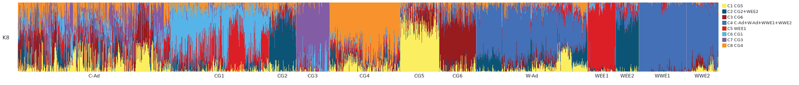

## 排序

你可以通过 `--order-file` 传入一个每行包含一个样本编号（IID）的文件来固定从左到右的样本排列顺序，该选项会覆盖 `--blocks`。如果不使用 `--order-file`，可以用 `--blocks` 传入以逗号分隔的分组名称列表来指定从左到右的分组顺序，未在列表中出现的分组会按字母顺序追加在后面。组名不能含逗号，因为逗号会把一个组名拆成两项。没有对应分组的样本会被归入 `--rest-name` 指定的分组名中（默认值为 `NA`）。

在每个分组内部，可以通过 `--within`（默认值为 `iid`）选择样本的排序方式：

* `iid`：按样本编号（ID）排序。
* `q`：按每个样本占比最高的祖先成分（即该样本数值最大的那一列）从大到小降序排列。
* `hclust`：在分组内部进行层次聚类（即根据样本间祖先成分的相似度把相近的样本聚在一起，需要安装 `scipy`）。
* `input`：保持输入 `.Q` 文件原本的行顺序。

此外，`--within-group G=method` 可以为单个分组 `G` 单独指定排序方法，该选项支持重复使用以设置多个分组。当使用 `q` 方式排序时，默认按样本自身的最高成分排，如果你指定了 `--sort-col N`（从 1 开始计数，对应对齐后的列 `C1`、`C2` 等），所有使用 `q` 排序的分组都会改为按第 `N` 列排序；`--sort-k` 则用于指定排序所依据的 K 值（默认使用最大的 K 值）。

### 组内聚类选项

以下聚类选项适用于所有使用了 `hclust` 的地方：

* `--hclust-dist`：设置距离度量方式（即计算两个样本祖先成分差异程度的方法），可选 `correlation`（默认值，等于 1 减去皮尔逊相关系数，皮尔逊相关系数用于衡量两个样本成分变化趋势的一致性）、`euclidean`（欧氏距离，即直线距离）或 `braycurtis`（Bray-Curtis 距离，常用于衡量生态或成分组成差异）。注意，如果某个样本的所有数值全为零，`braycurtis` 会产生 `NaN`（非数字，代表无效的空值）距离。
* `--hclust-linkage`：设置连接方法（即在聚类过程中计算两个样本集合之间距离的规则），可选 `average`（默认值，平均连接）、`ward`（Ward 方差最小化连接）或 `complete`（完全连接，即取最远距离）。注意，`ward` 要求 `--hclust-dist` 必须为 `euclidean`，否则即使没有任何分组实际使用 `hclust`，qbar 也会在启动时直接停止运行。
* `--hclust-olo`：默认关闭，开启后会基于相同的距离度量使用最优叶节点排序（optimal leaf ordering，一种在不破坏聚类树结构的前提下翻转分支，使相邻样本尽可能相似的算法，参考 Bar-Joseph et al. 2001）对聚类树的叶节点（即最终排列的各个样本）重新排序。
* `--hclust-pre`：可选 `dominant`（默认值为 `none`），它会先在每个分组内部按每个样本数值最高的列将样本拆分成不同的子块（如果最高值出现并列，则归入编号较小的列），子块按 `C1`、`C2` 等顺序排列，然后再在每个子块内部进行聚类。由于它使用的是对齐后的列，因此结果会依赖于列对齐方式和 `--anchor-group`。

以上所有聚类计算都只在单个 K 值（由 `--hclust-k` 指定，默认跟随 `--sort-k`）上进行；计算得到的样本顺序会直接应用到每一个 K 值上，因此所有 K 值下的样本排列顺序完全一致。使用默认设置时，生成的顺序与之前的版本完全相同。更多细节可参考官方文档：[https://docs.scipy.org/doc/scipy/reference/generated/scipy.cluster.hierarchy.linkage.html](https://docs.scipy.org/doc/scipy/reference/generated/scipy.cluster.hierarchy.linkage.html) 和 [https://docs.scipy.org/doc/scipy/reference/generated/scipy.cluster.hierarchy.optimal_leaf_ordering.html](https://docs.scipy.org/doc/scipy/reference/generated/scipy.cluster.hierarchy.optimal_leaf_ordering.html)

### 聚类示例

以下示例均基于 `demo/2448` 数据集（K 值从 2 到 6）并开启 `--within hclust` 运行，用来对比不同聚类参数与默认设置相比会有多少个样本（共 2448 个）的排列位置发生变化。

默认设置使用 `correlation` 距离和 `average` 连接，作为后续对比的基准。

```bash
python3 qbar.py --q 'demo/2448/ref2448_pruned.[2-6].Q' --fam demo/2448/ref2448_pruned.fam --groups demo/2448/groups.tsv --id-col id --group-col group --blocks C-Ad,CG1,CG2,CG3,CG4,CG5,CG6,W-Ad,WEE1,WEE2,WWE1,WWE2 --within hclust --anchor-group WWE1 --outdir out/d_hclust
```

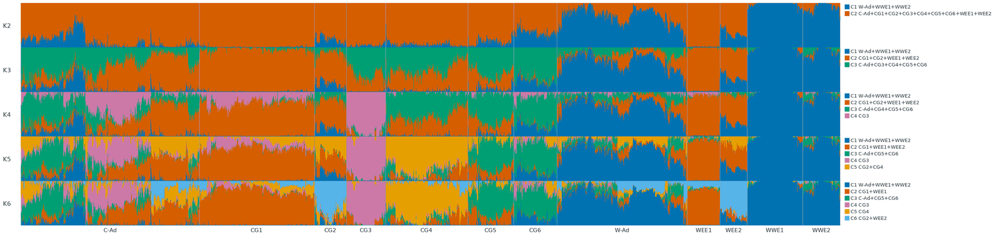

改用 `euclidean` 距离后，在全部 2448 个样本中，有 2417 个样本的位置相对于默认结果发生了变化。

```bash
python3 qbar.py --q 'demo/2448/ref2448_pruned.[2-6].Q' --fam demo/2448/ref2448_pruned.fam --groups demo/2448/groups.tsv --id-col id --group-col group --blocks C-Ad,CG1,CG2,CG3,CG4,CG5,CG6,W-Ad,WEE1,WEE2,WWE1,WWE2 --within hclust --hclust-dist euclidean --anchor-group WWE1 --outdir out/k_hc_euclidean
```


改用 `braycurtis` 距离后，在全部 2448 个样本中，有 2424 个样本的位置相对于默认结果发生了变化。

```bash
python3 qbar.py --q 'demo/2448/ref2448_pruned.[2-6].Q' --fam demo/2448/ref2448_pruned.fam --groups demo/2448/groups.tsv --id-col id --group-col group --blocks C-Ad,CG1,CG2,CG3,CG4,CG5,CG6,W-Ad,WEE1,WEE2,WWE1,WWE2 --within hclust --anchor-group WWE1 --hclust-dist braycurtis --outdir out/k_hc_braycurtis
```

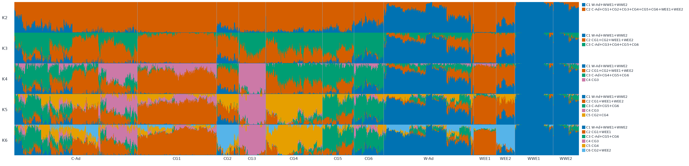

改用 `ward` 连接（需要同时配合 `euclidean` 距离使用）后，在全部 2448 个样本中，有 2419 个样本的位置相对于默认结果发生了变化。

```bash
python3 qbar.py --q 'demo/2448/ref2448_pruned.[2-6].Q' --fam demo/2448/ref2448_pruned.fam --groups demo/2448/groups.tsv --id-col id --group-col group --blocks C-Ad,CG1,CG2,CG3,CG4,CG5,CG6,W-Ad,WEE1,WEE2,WWE1,WWE2 --within hclust --anchor-group WWE1 --hclust-dist euclidean --hclust-linkage ward --outdir out/k_hc_ward
```

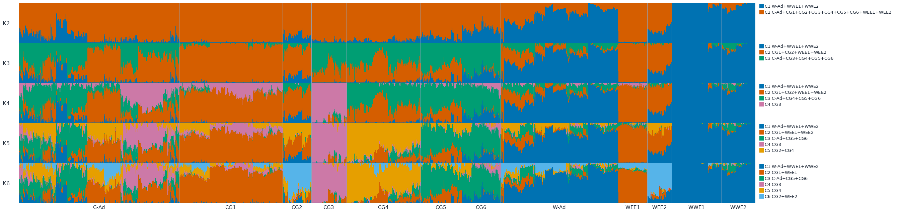

改用 `complete` 连接后，在全部 2448 个样本中，有 2423 个样本的位置相对于默认结果发生了变化。

```bash
python3 qbar.py --q 'demo/2448/ref2448_pruned.[2-6].Q' --fam demo/2448/ref2448_pruned.fam --groups demo/2448/groups.tsv --id-col id --group-col group --blocks C-Ad,CG1,CG2,CG3,CG4,CG5,CG6,W-Ad,WEE1,WEE2,WWE1,WWE2 --within hclust --anchor-group WWE1 --hclust-linkage complete --outdir out/k_hc_complete
```

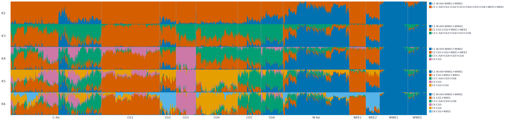

开启 `--hclust-olo` 最优叶节点排序后，在全部 2448 个样本中，有 2391 个样本的位置相对于默认结果发生了变化。

```bash
python3 qbar.py --q 'demo/2448/ref2448_pruned.[2-6].Q' --fam demo/2448/ref2448_pruned.fam --groups demo/2448/groups.tsv --id-col id --group-col group --blocks C-Ad,CG1,CG2,CG3,CG4,CG5,CG6,W-Ad,WEE1,WEE2,WWE1,WWE2 --within hclust --anchor-group WWE1 --hclust-olo --outdir out/k_hc_olo
```

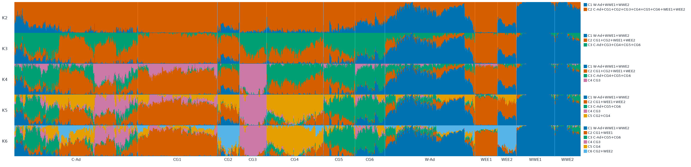

开启 `--hclust-pre dominant` 预拆分（即先按样本最高占比列分块再聚类）后，在全部 2448 个样本中，有 1516 个样本的位置相对于默认结果发生了变化。

```bash
python3 qbar.py --q 'demo/2448/ref2448_pruned.[2-6].Q' --fam demo/2448/ref2448_pruned.fam --groups demo/2448/groups.tsv --id-col id --group-col group --blocks C-Ad,CG1,CG2,CG3,CG4,CG5,CG6,W-Ad,WEE1,WEE2,WWE1,WWE2 --within hclust --anchor-group WWE1 --hclust-pre dominant --outdir out/k_hc_pre_dominant
```

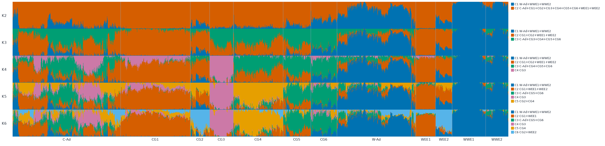

## 常见任务

如果你想自定义样本排列顺序，可以使用自带的 `demo/2448/order.txt` 作为示例，准备自己的列表时只需每行写一个样本编号（IID，即每个样本的唯一名称）。传入 `--order-file` 选项即可固定图表中从左到右的样本顺序。

```text
106-A
13
136
14-A
15-A
```

```bash
python3 qbar.py --q demo/2448/ref2448_pruned.8.Q --fam demo/2448/ref2448_pruned.fam --groups demo/2448/groups.tsv --id-col id --group-col group --order-file demo/2448/order.txt --outdir out
```

终端输出如下：

```text
out/bar_K8.png
order	out/order.tsv
```

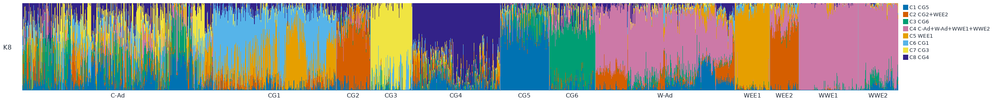

在对比组内排序方式时，默认的 `iid` 会按样本编号排序，而 `hclust`（层次聚类）则会把祖先成分构成相似的样本聚在一起。这里不再重复展示 `hclust` 示例，关于 `hclust` 及其各项聚类参数的详细效果，请直接查看上文的聚类示例一节。

```bash
python3 qbar.py --q 'demo/2448/ref2448_pruned.[2-6].Q' --fam demo/2448/ref2448_pruned.fam --groups demo/2448/groups.tsv --id-col id --group-col group --blocks C-Ad,CG1,CG2,CG3,CG4,CG5,CG6,W-Ad,WEE1,WEE2,WWE1,WWE2 --within iid --anchor-group WWE1 --outdir out/d_iid
```

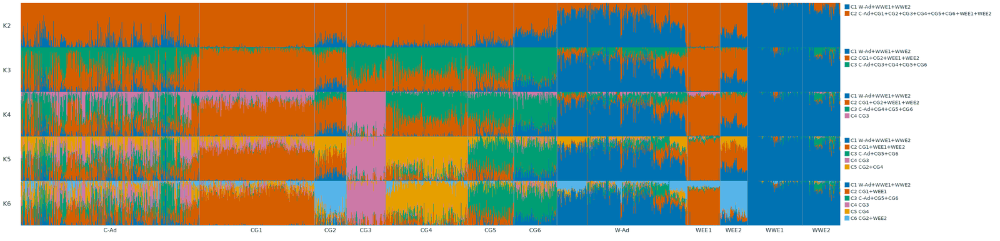

你可以通过 `NAME=#rrggbb` 格式为特定分组指定颜色，或通过 `C3=#rrggbb` 格式为对齐后的特定列指定颜色（其中 `#rrggbb` 是代表红绿蓝配比的十六进制颜色代码）。名字是第一个等号前面的文字，所以组名不能含等号。

```bash
python3 qbar.py --q 'demo/2448/ref2448_pruned.[2-6].Q' --fam demo/2448/ref2448_pruned.fam --groups demo/2448/groups.tsv --id-col id --group-col group --blocks C-Ad,CG1,CG2,CG3,CG4,CG5,CG6,W-Ad,WEE1,WEE2,WWE1,WWE2 --within q --anchor-group WWE1 --color WWE1=#4470b7 --color WEE1=#dc1f26 --color CG4=#f7922c --color C3=#2ca02c --outdir out/e_color
```

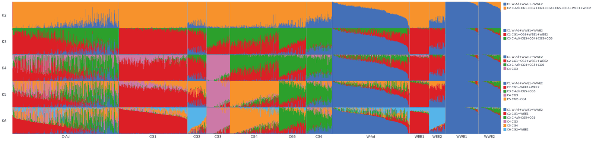

如果你希望保留 ADMIXTURE 输出的原始列顺序，不进行跨 K 值的列对齐（即不把不同 K 值下代表同一祖先群体的列排成同一颜色），可以加上 `--no-align` 选项。若同时给了 `--anchor-group`，每个 K 仍把该组最纯的人的主列放到 C1：

```bash
python3 qbar.py --q 'demo/2448/ref2448_pruned.[2-6].Q' --fam demo/2448/ref2448_pruned.fam --groups demo/2448/groups.tsv --id-col id --group-col group --blocks C-Ad,CG1,CG2,CG3,CG4,CG5,CG6,W-Ad,WEE1,WEE2,WWE1,WWE2 --within iid --no-align --outdir out/c_noalign
```

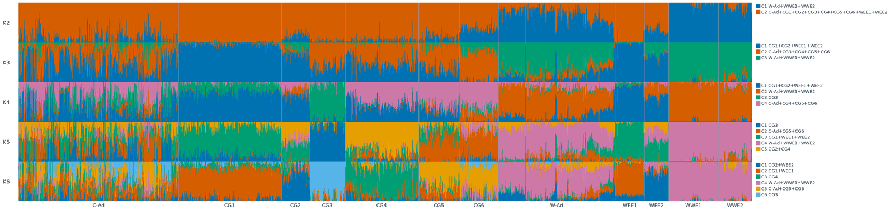

## 列对齐

当输入包含 2 个或更多 K 值时，程序会进行列对齐（即把不同 K 值下代表同一个祖先群体的列对应起来并使用同一种颜色，该功能默认开启，加上 `--no-align` 则保留每个 Q 自己的列顺序；若同时给了 `--anchor-group`，每个 K 仍把该组最纯的人的主列放到 C1）。对齐是按 K-1 到 K 逐步进行的：将前一个 K 值（K-1）的旧列与当前 K 值的新列进行匹配，多出来的那一个未匹配新列会排在最后成为新的末尾列。`--align-mode` 用于选择参与对齐计算的样本范围，默认值 `all` 会使用 `--align-groups` 指定的分组中的样本（若未指定则使用所有样本）；`core` 则只保留在相邻两个 K 值下最高祖先成分占比都高于 `--qmax`（默认值为 `0.75`）的核心样本。`--anchor-group G` 会在最小的 K 值下，把分组 `G` 中成分最纯粹的样本（即单一祖先成分占比最高的样本）的主导列固定在第 1 列 `C1` 的位置。

### 如何选择对齐方法

你可以通过 `--align-method` 选择对齐方法，可选 `greedy`、`hungarian`、`pong` 或 `jaccard`，其中 `greedy` 是默认值，所有方法都会使用相同的样本集合进行计算：

* `greedy`：贪心算法（即每一步都直接做当前看来最优的选择），它会按 `C1`、`C2` 等顺序依次为每个旧列挑选尚未被使用且皮尔逊相关系数 `r`（衡量两列数值变化趋势一致性的指标）最高的新列；如果遇到得分并列，则优先选择编号较小的列；当匹配的皮尔逊相关系数小于 0.5 时，会在标准错误输出 `stderr`（即终端里专门显示警告和报错信息的通道）中打印警告。这种方法速度快，在各列对应关系清晰时表现良好，但列的先后处理顺序可能会影响最终结果。
* `hungarian`：匈牙利算法（一种寻找全局最优一对一匹配的数学算法），它会找出整体皮尔逊相关系数总和最高的一对一列匹配方案。当 `greedy` 提示皮尔逊相关系数过低，或者有两列同时争夺同一个匹配目标时，建议使用此方法。在演示数据集上，它生成的列顺序与 `greedy` 相同。
* `pong`：参考 Behr et al. 2016 的思路，但属于 qbar 自己的独立实现，并未直接调用 pong 软件的代码。它按照 pong 手册中的公式 1，在满足 `a_i + b_i > 0`（即两个待比较列中至少有一列占比大于 0）的样本上计算相似度（而 pong 原版代码则是筛选占比至少达到 `0.1/K` 的样本）。该方法会尝试将新 K 值下的每一对列合并成一列来进行测试，与获胜合并列匹配上的那个旧列就是发生分化的父列（即随着 K 增加而一分为二的祖先成分），至于分化出的两半中哪一半留在父列原本的位置，则遵循 qbar 自己的规则。使用该方法时，`align.tsv` 的列名为 `K_to`、`n_mask`、`pong_sim` 和 `split_parent`，且不会输出皮尔逊相关系数警告。当某个祖先成分在 K 增加时明显一分为二时适合使用此方法，在演示数据集上它的结果顺序与 `greedy` 相同。
* `jaccard`：这是 qbar 独创的方法，它根据哪些样本主要归属于哪一列来进行匹配。你可以通过 `--jaccard-set` 定义每一列的成员集合，默认的 `dominant` 会把在该列占比最高的样本归入集合，而 `threshold` 则会把该列占比至少达到 `--jaccard-cut`（默认值为 `0.5`）的样本归入集合；随后计算两个集合的杰卡德指数（Jaccard，等于两个集合共同拥有的样本数除以两个集合合并后的总样本数）。使用该方法时，`align.tsv` 的列名为 `K_to`、`n_mask` 和 `jaccard`。与其他工具相比，CLUMPAK 和 CLUMPP 是直接根据 Q 矩阵数值的整体相似度来对齐，而 `jaccard` 则是利用成员集合的重叠度来对齐。需要注意的是，配合 `--anchor-group` 使用时，被锚定在 `C1` 的成分可能会在中途离开 `C1`（例如在演示数据的 K10 到 K12 中，`W-Ad` 留在了 `C1`，而 `WWE1` 变成了 `C10`）。当数据集中存在大量混合样本（admixed，即一个样本同时混有多个比例相近的祖先成分）时，建议尝试将 `--jaccard-set` 设为 `threshold`。

实际使用时，建议先运行默认设置，然后加上 `--align-report` 与其他对齐方法进行对比；如果不同方法给出的结果一致，直接保留默认设置即可。

### 对齐示例

以下示例均基于 `demo/2448` 数据集（K 值从 2 到 12）运行，用来对比不同对齐方法的效果。在演示数据中，`hungarian` 和 `pong` 在每一个 K 值下生成的列顺序都与默认的 `greedy` 相同，而 `jaccard` 的两种集合定义方式在 K3 到 K9 时与默认结果一致，但在 K10 时会将 `C1` 和 `C10` 互换，并将这一变化延续到 K12。

使用 `hungarian` 方法（即寻找全局最优一对一皮尔逊相关系数匹配的匈牙利算法）时，每一个 K 值下的列排列顺序都与默认的 `greedy` 完全一致。

```bash
python3 qbar.py --q 'demo/2448/ref2448_pruned.*.Q' --fam demo/2448/ref2448_pruned.fam --groups demo/2448/groups.tsv --id-col id --group-col group --blocks C-Ad,CG1,CG2,CG3,CG4,CG5,CG6,W-Ad,WEE1,WEE2,WWE1,WWE2 --within iid --anchor-group WWE1 --color WWE1=#4470b7 --color WEE1=#dc1f26 --color WEE2=#0b5475 --color CG6=#981b1e --color CG4=#f7922c --color CG3=#835ca6 --color CG5=#fbee61 --color WWE2=#f6a3b1 --align-method hungarian --outdir out/g_hungarian
```


使用 `pong` 方法时，每一个 K 值下的列排列顺序同样与默认的 `greedy` 保持一致。该方法识别出的分化父列（即从前一个 K 值到当前 K 值时一分为二的旧列）依次为：K3 时为 `C2`，K4 时为 `C3`，K5 时为 `C3`，K6 时为 `C2`，K7 时为 `C3`，K8 时为 `C2`，K9 时为 `C1`，K10 时为 `C1`，K11 时为 `C6`，K12 时为 `C4`。

```bash
python3 qbar.py --q 'demo/2448/ref2448_pruned.*.Q' --fam demo/2448/ref2448_pruned.fam --groups demo/2448/groups.tsv --id-col id --group-col group --blocks C-Ad,CG1,CG2,CG3,CG4,CG5,CG6,W-Ad,WEE1,WEE2,WWE1,WWE2 --within iid --anchor-group WWE1 --color WWE1=#4470b7 --color WEE1=#dc1f26 --color WEE2=#0b5475 --color CG6=#981b1e --color CG4=#f7922c --color CG3=#835ca6 --color CG5=#fbee61 --color WWE2=#f6a3b1 --align-method pong --outdir out/h_pong
```


使用 `jaccard` 方法并搭配默认的 `dominant` 集合定义（即把在该列占比最高的样本归入该列的成员集合）时，K3 到 K9 的列排列顺序与默认结果一致，但在 K10 时会将 `C1` 和 `C10` 互换，并将这一变化延续到 K12。

```bash
python3 qbar.py --q 'demo/2448/ref2448_pruned.*.Q' --fam demo/2448/ref2448_pruned.fam --groups demo/2448/groups.tsv --id-col id --group-col group --blocks C-Ad,CG1,CG2,CG3,CG4,CG5,CG6,W-Ad,WEE1,WEE2,WWE1,WWE2 --within iid --anchor-group WWE1 --color WWE1=#4470b7 --color WEE1=#dc1f26 --color WEE2=#0b5475 --color CG6=#981b1e --color CG4=#f7922c --color CG3=#835ca6 --color CG5=#fbee61 --color WWE2=#f6a3b1 --align-method jaccard --outdir out/i_jaccard
```


使用 `jaccard` 方法并搭配 `threshold` 集合定义（即把该列占比至少达到指定阈值的样本归入成员集合）时，结果同样在 K3 到 K9 与默认设置一致，并在 K10 时将 `C1` 和 `C10` 互换且一直延续到 K12。

```bash
python3 qbar.py --q 'demo/2448/ref2448_pruned.*.Q' --fam demo/2448/ref2448_pruned.fam --groups demo/2448/groups.tsv --id-col id --group-col group --blocks C-Ad,CG1,CG2,CG3,CG4,CG5,CG6,W-Ad,WEE1,WEE2,WWE1,WWE2 --within iid --anchor-group WWE1 --color WWE1=#4470b7 --color WEE1=#dc1f26 --color WEE2=#0b5475 --color CG6=#981b1e --color CG4=#f7922c --color CG3=#835ca6 --color CG5=#fbee61 --color WWE2=#f6a3b1 --align-method jaccard --jaccard-set threshold --jaccard-cut 0.5 --outdir out/i_jaccard_thr
```

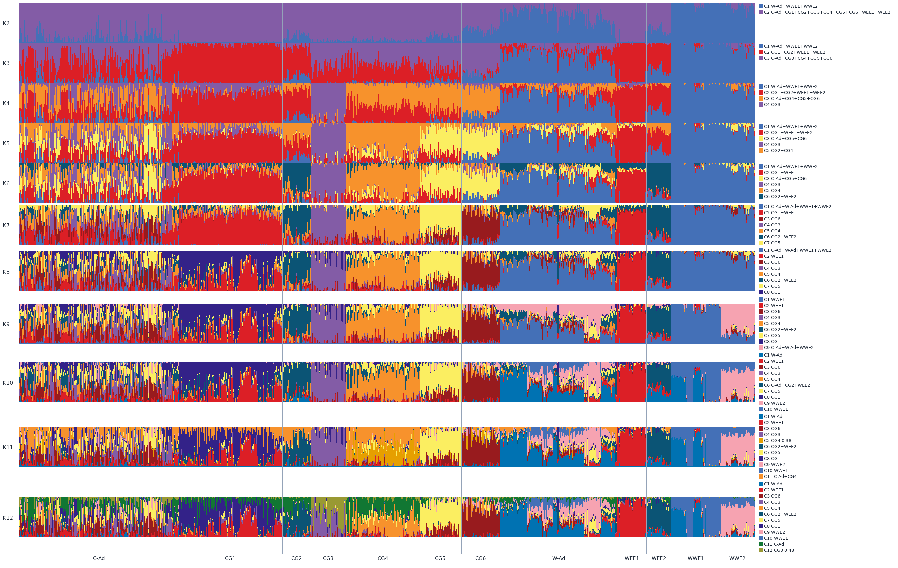

### 读懂对齐报告

```bash
python3 qbar.py --q 'demo/2448/ref2448_pruned.*.Q' --fam demo/2448/ref2448_pruned.fam --groups demo/2448/groups.tsv --id-col id --group-col group --blocks C-Ad,CG1,CG2,CG3,CG4,CG5,CG6,W-Ad,WEE1,WEE2,WWE1,WWE2 --within iid --anchor-group WWE1 --color WWE1=#4470b7 --color WEE1=#dc1f26 --color WEE2=#0b5475 --color CG6=#981b1e --color CG4=#f7922c --color CG3=#835ca6 --color CG5=#fbee61 --color WWE2=#f6a3b1 --align-report --outdir out/j_report
```

`--align-report` 选项默认关闭，开启后且输入包含 2 个或更多 K 值时，程序会在 `align.tsv` 同级目录下生成 `align_report.tsv`（制表符分隔的表格文件）和 `align_report.txt`（英文纯文本报告，每一步 K 值变化占一个段落块）；该选项支持全部四种对齐方法，在表格中每个 K 值的每一列对应一行。如果需要调整方法或阈值（即判断信度高低的临界数值），可以加上 `--align-method pong --align-report-low 0.8`。下面是运行 `demo/2448` 快速上手命令并加上 `--align-report`（使用默认的 `greedy` 方法）所生成的 `align_report.txt` 节选内容：

```text
Alignment report
method: greedy (similarity = Pearson r)
low confidence: similarity < 0.5
split parent: K-1 column with the largest membership-weighted mean over the new column

K=2 -> K=3 (people used: 2448)
  C1 <- C1  Pearson r 0.995; top groups: WWE1:0.972;WWE2:0.885;W-Ad:0.684
  C2 <- C2  Pearson r 0.748; top groups: WEE1:0.968;CG1:0.952;CG2:0.699
  C3 new, split from C2 (parent share 0.804; runner-up C1 0.196); top groups: CG6:0.736;CG3:0.609;CG5:0.605
```

`align_report.tsv` 包含以下各列：

* `K_to`：当前对齐到的目标 K 值。
* `column`：对齐后的列名（如 `C1`、`C2`）。
* `raw_column`：该列在当前 K 值的原始 `.Q` 文件中的列号（从 1 开始计数）。
* `matched_from`：在 K-1 中匹配到的来源列名（格式为 `C#`），如果是当前 K 值多出来的新列则显示为 `new`。
* `method`：本次使用的对齐方法名称。
* `similarity`：对应对齐方法自身计算的相似度得分。
* `pearson`：供参考的皮尔逊相关系数（衡量两列数值变化趋势一致性的指标）。
* `low_confidence`：低置信度标记（即匹配结果不够可靠），如果 `similarity` 低于设定的阈值则记为 `yes`，新增的列记为 `NA`（代表无适用值）。
* `split_parent`：分化父列，即当前新增列主要由 K-1 中的哪一列分化而来。
* `parent_share`：分化父列在新增列中所占的成分比例（share）。
* `runner_up`：在新增列中占比排第二的 K-1 次要来源列。
* `runner_up_share`：次要来源列在新增列中所占的成分比例。
* `top_groups_mean`：在该列中平均占比最高的前 3 个样本分组。
* `n_dominant`：以该列作为最高占比成分的样本数量。
* `top_groups_dominant`：在该列作为最高成分的样本中，包含样本数最多的前几个分组。

在判定分化父列（`split_parent`）时，`greedy`、`hungarian` 和 `jaccard` 会直接选取贡献比例（share）最大的旧列；而 `pong` 则选取与分化合并列对相匹配的那个旧列，因此两者的结果可能不同（例如在演示数据的 K4 和 K5 中，`pong` 选出的 `C3` 占比分别为 0.395 和 0.378，而占比最高的 `C2` 分别为 0.549 和 0.459）。如果遇到比例并列，则归入编号较小的列。如果新增列的所有数值总和为 0，与分化相关的字段都会记为 `NA`。当比例低于约 0.5 时，该结果仅具参考意义（例如演示数据中 K6 为 0.414，K7 为 0.385，K11 中最高与次高分别为 0.265 与 0.251）。

用于判定低置信度（`low_confidence`）的默认阈值在 `greedy`、`hungarian` 和 `jaccard` 下为 0.5，在 `pong` 下为 0.8，这些数值是 qbar 自己设定的经验规则而非出自某篇文献，你可以通过 `--align-report-low` 自行修改。在演示数据集上，`greedy`、`hungarian` 和 `pong` 均没有出现低置信度的行，而 `jaccard` 会将 K8 的 `C2`（0.496）和 K11 的 `C5`（0.480）标记为低置信度。

## 常见报错

- `需要 --fam（PLINK .fam）或 --ids（一行一个 IID，顺序与 Q 的行一致）`
  缺少样本名单参数。

- `--fam 和 --ids 只留一个`
  同时提供了两种名单文件，只保留一个。

- `没有匹配到 Q：demo/nothere/*.Q`
  通配符没有匹配到文件，检查路径是否正确。

- `out/ref.4.Q 文件名是 K=4，列数是 3`
  Q 矩阵的列数与文件名里的 K 数字不一致。

- `K=3 的 Q 有 100 行，样本名单有 2448 行`
  Q 矩阵的行数与样本名单数目不匹配。

- `颜色要写成 #rrggbb，收到 blue`
  颜色只能使用十六进制格式输入。

- `锚定组 NOPE 在样本里没有人`
  指定的组名不在当前样本群体表中。

- `要跨 K 对齐，K 必须连续。缺 K=3`
  需要计算的 K 值断层，确保提供的 K 值连续。

- `--sort-col 要在 1 到 3 之间`
  指定用于排序的列号超出了祖先成分数目。

- `hclust 需要 scipy（scipy.cluster.hierarchy）`
  当前环境没有 scipy 库，使用 pip 安装。

- `--align-method hungarian 需要 scipy（scipy.optimize）`
  `hungarian`、`pong` 和 `jaccard` 这三种对齐方法都需要用到 `scipy`（报错信息会显示你当时实际选择的方法名），请运行 `pip install scipy` 安装（`scipy` 已包含在 `requirements.txt` 中），或者改用默认的 `greedy` 方法。

- `--hclust-linkage ward 需要 --hclust-dist euclidean，收到 correlation`
  `ward` 连接方法只能搭配 `euclidean`（欧氏距离）使用，请加上 `--hclust-dist euclidean` 选项，或者将连接方法改为 `average` 或 `complete`。

## 引用

- pong 对齐方法参考了 Behr AA, Liu KZ, Liu-Fang G, Nakka P, Ramachandran S. Bioinformatics 2016;32(18):2817-2823，doi（数字对象唯一标识符，即学术论文的永久链接编号）为 [10.1093/bioinformatics/btw327](https://doi.org/10.1093/bioinformatics/btw327)。
- CLUMPAK（仅作为与 qbar 基于成员集合的 `jaccard` 方法进行对比的参考，CLUMPAK 本身是根据 Q 矩阵的相似度来对齐不同运行结果的）参考了 Kopelman NM, Mayzel J, Jakobsson M, Rosenberg NA, Mayrose I. Mol Ecol Resour 2015;15(5):1179-1191，doi 为 [10.1111/1755-0998.12387](https://doi.org/10.1111/1755-0998.12387)。
- 最优叶节点排序（Optimal leaf ordering）参考了 Bar-Joseph Z, Gifford DK, Jaakkola TS. Bioinformatics 2001;17 Suppl 1:S22-S29，doi 为 [10.1093/bioinformatics/17.suppl_1.S22](https://doi.org/10.1093/bioinformatics/17.suppl_1.S22)。
- CLUMPP 参考了 Jakobsson and Rosenberg 2007 Bioinformatics 23:1801，doi 为 [10.1093/bioinformatics/btm233](https://doi.org/10.1093/bioinformatics/btm233)。
- 标签切换背景（Label switching，即不同运行或不同 K 值之间各列的顺序和标签发生任意变动的问题）参考了 Alexander, Novembre and Lange 2009 Genome Res 19:1655，doi 为 [10.1101/gr.094052.109](https://doi.org/10.1101/gr.094052.109)。
